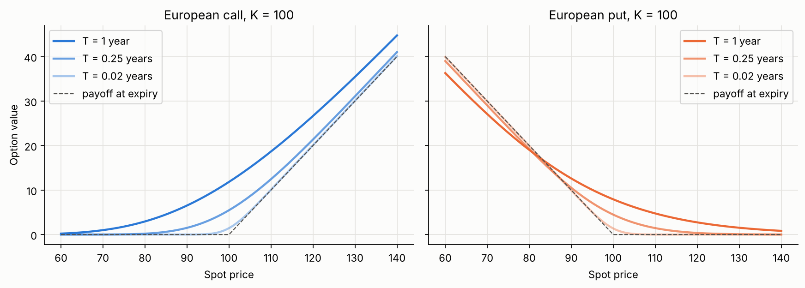
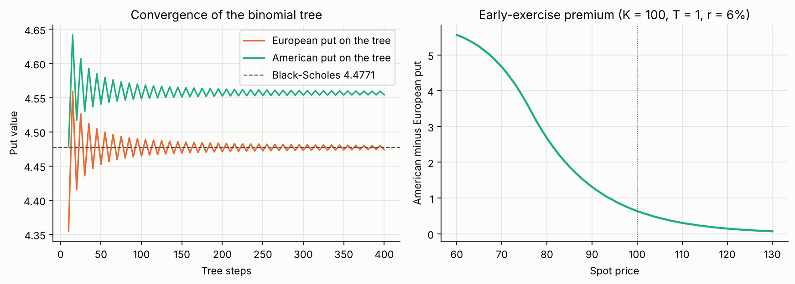
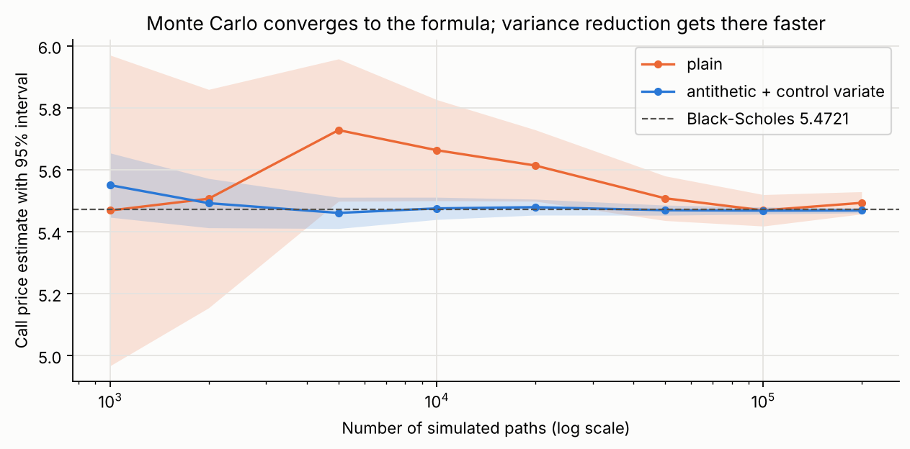
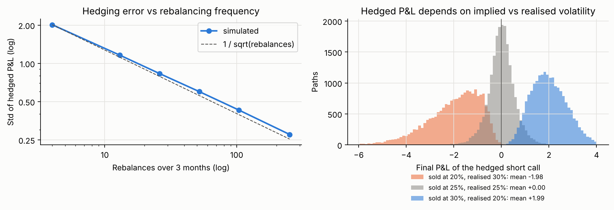

# Option Pricing Lab: Black-Scholes, Binomial Trees, Monte Carlo and Delta Hedging

A tested Python toolkit for pricing equity options and understanding where their value and risk come from:
closed-form Black-Scholes-Merton prices and Greeks, American options on a binomial tree, Monte Carlo with variance
reduction, a delta-hedging simulation, and implied-volatility tools for real option chains.

## What it does

- Prices European **calls and puts**, with an optional continuous **dividend yield**.
- Computes the **Greeks** for both calls and puts: delta, gamma, vega, theta and rho.
- Recovers **implied volatility** with Brent's method, which always converges inside its search range, and rejects
  prices that break the no-arbitrage bounds (where no volatility can fit).
- Estimates **historical volatility** from daily log returns.
- Prices **American options** on a Cox-Ross-Rubinstein binomial tree and measures the **early-exercise premium**.
- Prices by **Monte Carlo**, with standard errors and two variance-reduction methods (antithetic draws and a control
  variate); together they cut the standard error about fourfold for the same number of paths.
- **Simulates delta hedging** a short option: the hedging error falls with the square root of the number of
  rebalances, and selling volatility above what the stock realises earns about vega x (implied - realised) on average.
- `price_option.py` downloads a year of prices and an at-the-money option quote and reports **implied versus
  historical volatility**; `vol_smile.py` plots **implied volatility across strikes** for a ticker.
- All functions work on NumPy arrays, so a whole grid of spots, strikes or volatilities is priced in one call.

## Run

```bash
pip install -r requirements.txt
python price_option.py AAPL                  # needs internet (Yahoo Finance via yfinance)
python price_option.py MSFT --rate 0.04 --dividend-yield 0.007
python vol_smile.py SPY                      # implied volatility smile, saved as smile_SPY.png
```

Example output (from the test suite's simulated quotes, priced at 35% volatility):

```
DEMO  spot 103.00   historical volatility (1y) 19.2%
Option: strike 103.00, expiry 2027-01-15 (30 days)

          market   model (hist. vol)   implied vol
call        4.29                2.43         35.0%
      the market prices more volatility than the past 1y (35.0% vs 19.2%)
put         3.95                2.09         35.0%
      the market prices more volatility than the past 1y (35.0% vs 19.2%)
```

### Why "implied vs historical" and not "cheap vs expensive"

A model price computed with historical volatility will usually differ from the market price. That gap does not show
that the option is mispriced. It shows that the market expects a different volatility from the one measured in the
past. Comparing the two volatilities states this directly.

The notebook `option_pricing_demo.ipynb` runs offline and walks through every part: prices, Greeks, implied volatility, binomial trees, Monte Carlo and delta hedging.

## Results




### American options on a binomial tree

The European price on the tree oscillates towards Black-Scholes as steps increase; the American put is worth more
because it can be exercised early, and that premium grows as the put goes deeper in the money.



### Monte Carlo and variance reduction



| Method (100,000 paths) | Standard error |
|---|---|
| Plain | 0.026 |
| Antithetic draws | 0.019 |
| Control variate (stock price) | 0.012 |
| Both | 0.006 |

### Delta hedging

Selling a 3-month at-the-money call and delta hedging it. Left: the spread of the final P&L falls in line with
1 / sqrt(rebalances). Right: when the option is sold 10 volatility points above what the stock then realises, the
hedged position earns +1.99 on average, close to the vega approximation of 1.97; selling 10 points too cheap loses
about the same.



## The model

For spot $S$, strike $K$, time to expiry $T$ (years), rate $r$, dividend yield $q$ and volatility $\sigma$:

$$d_1 = \frac{\ln(S/K) + (r - q + \tfrac{1}{2}\sigma^2)T}{\sigma\sqrt{T}}, \qquad d_2 = d_1 - \sigma\sqrt{T}$$

$$C = S e^{-qT} N(d_1) - K e^{-rT} N(d_2), \qquad P = K e^{-rT} N(-d_2) - S e^{-qT} N(-d_1)$$

| Greek | Call | Put |
|---|---|---|
| Delta | $e^{-qT} N(d_1)$ | $e^{-qT} (N(d_1) - 1)$ |
| Gamma | $e^{-qT} \varphi(d_1) / (S \sigma \sqrt{T})$ | same |
| Vega | $S e^{-qT} \varphi(d_1) \sqrt{T}$ | same |
| Rho | $K T e^{-rT} N(d_2)$ | $-K T e^{-rT} N(-d_2)$ |

Theta is in `black_scholes.theta`; `black_scholes.greeks()` returns theta per day and vega and rho per 1 point,
as they are usually quoted.

## Tests

```bash
pip install -r requirements-dev.txt
python -m pytest
```

The 49 tests run in about two seconds without internet. They check:

- Black-Scholes against the textbook example in Hull (S = 42, K = 40, r = 10%, sigma = 20%, T = 0.5: call 4.76,
  put 0.81), put-call parity with and without dividends, and every Greek against a numerical derivative.
- Implied volatility round trips from 5% to 200%, and rejection of prices outside the no-arbitrage bounds.
- The binomial tree against Hull's 5-step American put (4.49), convergence to Black-Scholes, and that an American call
  on a non-dividend stock is never exercised early.
- Monte Carlo estimates within four standard errors of the formula, and that variance reduction shrinks the error.
- The hedging simulation: near-zero mean P&L when implied equals realised volatility, error halving when rebalances
  quadruple, and the sign of the P&L when they differ.
- The smile code recovering a known volatility smile from a simulated option chain, and both scripts with simulated
  market data.

## Limitations

- `price_option.py` and `vol_smile.py` use Black-Scholes, i.e. European exercise. Most US single-stock options are
  American, so their implied volatilities are approximations, most of all for puts and for dividend payers;
  `binomial.py` prices the American version.
- The hedging simulation assumes no transaction costs and a constant realised volatility.
- Constant volatility and rates: Black-Scholes does not produce the volatility smile seen in real option markets.
- Yahoo Finance quotes can be delayed or stale; the script uses the bid-ask mid when both are available.

## Files

| File | Contents |
|---|---|
| `black_scholes.py` | Pricing, Greeks, implied and historical volatility (no internet needed) |
| `market_data.py` | Price history and option quotes from Yahoo Finance |
| `binomial.py` | Cox-Ross-Rubinstein tree for European and American options |
| `monte_carlo.py` | Monte Carlo pricing with antithetic draws and a control variate |
| `hedging.py` | Delta-hedging simulation |
| `price_option.py` | Command-line tool: implied vs historical volatility for a ticker |
| `vol_smile.py` | Command-line tool: implied volatility across strikes for a ticker |
| `option_pricing_demo.ipynb` | Offline walk-through with charts |
| `tests/` | Test suite |
| `docs/` | Earlier notes on the theory |
