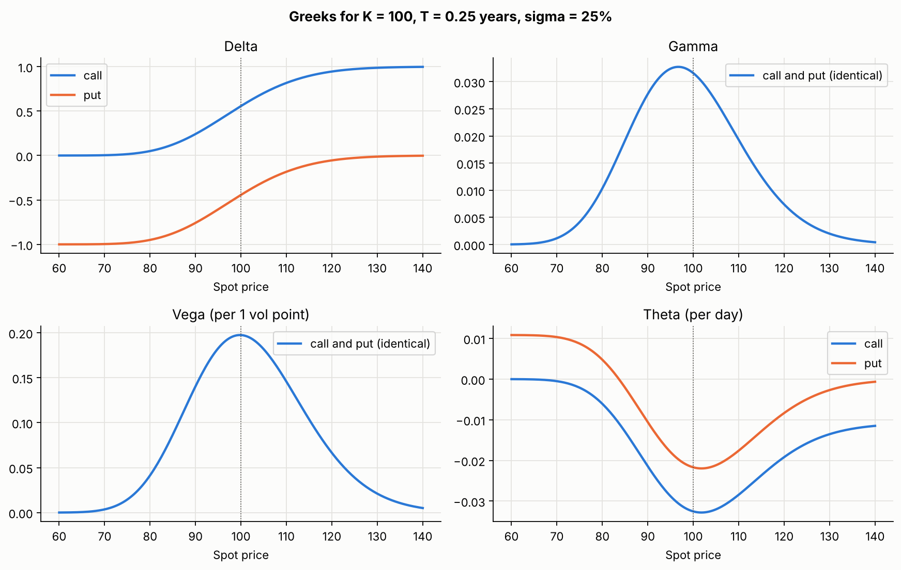
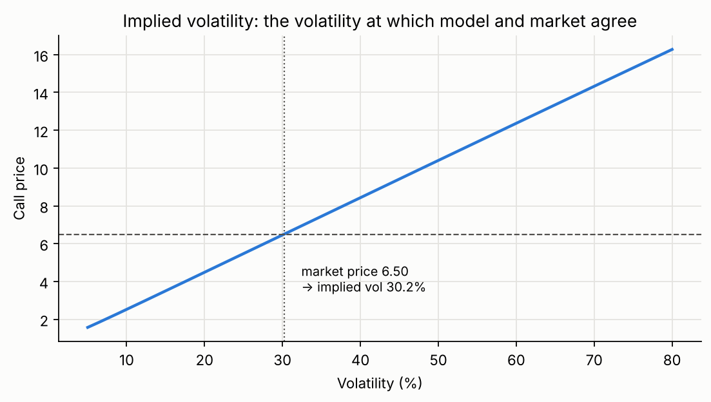

# Black-Scholes Option Pricing: Prices, Greeks and Implied Volatility

A tested Python implementation of the Black-Scholes-Merton model for European options, with a command-line tool
that compares the volatility implied by real option prices with the volatility measured from past returns.

## What it does

- Prices European **calls and puts**, with an optional continuous **dividend yield**.
- Computes the **Greeks** for both calls and puts: delta, gamma, vega, theta and rho.
- Recovers **implied volatility** with Brent's method, which always converges inside its search range, and rejects
  prices that break the no-arbitrage bounds (where no volatility can fit).
- Estimates **historical volatility** from daily log returns.
- `price_option.py` downloads a year of prices and an at-the-money option quote and reports **implied versus
  historical volatility**.
- All functions work on NumPy arrays, so a whole grid of spots, strikes or volatilities is priced in one call.

## Run

```bash
pip install -r requirements.txt
python price_option.py AAPL                  # needs internet (Yahoo Finance via yfinance)
python price_option.py MSFT --rate 0.04 --dividend-yield 0.007
```

Example output (from the test suite's simulated quotes, priced at 35% volatility):

```
DEMO  spot 103.00   historical volatility (1y) 19.2%
Option: strike 103.00, expiry 2027-01-15 (30 days)

          market   model (hist. vol)   implied vol
call        4.29                2.43         35.0%
      the market prices more volatility than the past 1y (35.0% vs 19.2%)
put         3.95                2.09         35.0%
      the market prices more volatility than the past 1y (35.0% vs 19.2%)
```

### Why "implied vs historical" and not "cheap vs expensive"

A model price computed with historical volatility will usually differ from the market price. That gap does not show
that the option is mispriced. It shows that the market expects a different volatility from the one measured in the
past. Comparing the two volatilities states this directly.

The notebook `option_pricing_demo.ipynb` runs offline and walks through prices, the Greeks and implied volatility.

## Results






## The model

For spot $S$, strike $K$, time to expiry $T$ (years), rate $r$, dividend yield $q$ and volatility $\sigma$:

$$d_1 = \frac{\ln(S/K) + (r - q + \tfrac{1}{2}\sigma^2)T}{\sigma\sqrt{T}}, \qquad d_2 = d_1 - \sigma\sqrt{T}$$

$$C = S e^{-qT} N(d_1) - K e^{-rT} N(d_2), \qquad P = K e^{-rT} N(-d_2) - S e^{-qT} N(-d_1)$$

| Greek | Call | Put |
|---|---|---|
| Delta | $e^{-qT} N(d_1)$ | $e^{-qT} (N(d_1) - 1)$ |
| Gamma | $e^{-qT} \varphi(d_1) / (S \sigma \sqrt{T})$ | same |
| Vega | $S e^{-qT} \varphi(d_1) \sqrt{T}$ | same |
| Rho | $K T e^{-rT} N(d_2)$ | $-K T e^{-rT} N(-d_2)$ |

Theta is in `black_scholes.theta`; `black_scholes.greeks()` returns theta per day and vega and rho per 1 point,
as they are usually quoted.

## Tests

```bash
pip install -r requirements-dev.txt
python -m pytest
```

The 22 tests check prices against the textbook example in Hull (S = 42, K = 40, r = 10%, sigma = 20%, T = 0.5:
call 4.76, put 0.81), put-call parity with and without dividends, every Greek against a numerical derivative of the
price, implied volatility round trips from 5% to 200%, rejection of impossible prices, and the command-line script
with simulated market data.

## Limitations

- European exercise only. Most US single-stock options are American, so for those the results are approximations,
  most of all for puts and for stocks paying dividends.
- Constant volatility and rates: Black-Scholes does not produce the volatility smile seen in real option markets.
- Yahoo Finance quotes can be delayed or stale; the script uses the bid-ask mid when both are available.

## Files

| File | Contents |
|---|---|
| `black_scholes.py` | Pricing, Greeks, implied and historical volatility (no internet needed) |
| `market_data.py` | Price history and option quotes from Yahoo Finance |
| `price_option.py` | Command-line tool: implied vs historical volatility for a ticker |
| `option_pricing_demo.ipynb` | Offline walk-through with charts |
| `tests/` | Test suite |
| `docs/` | Earlier notes on the theory |
